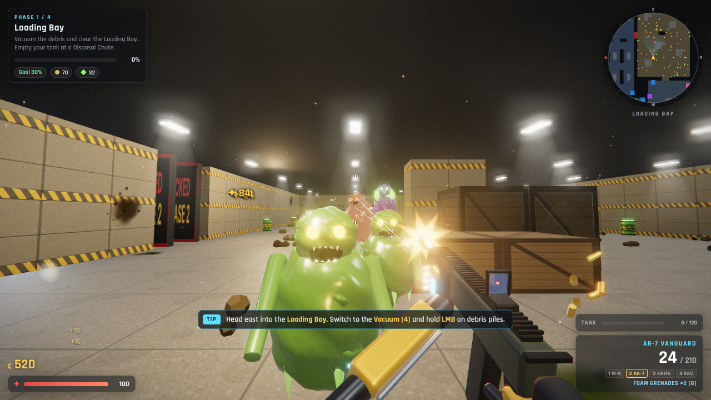
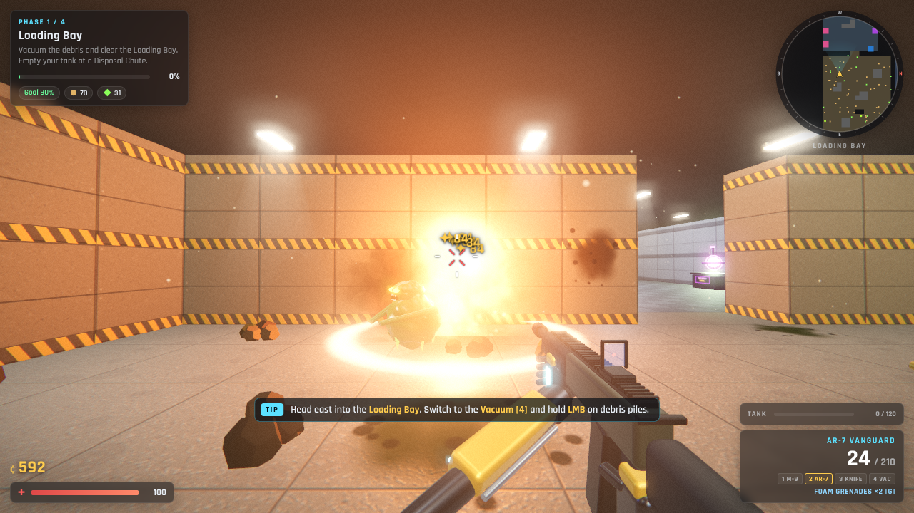
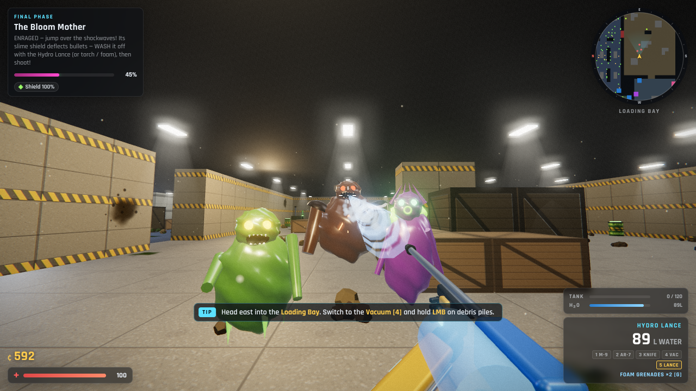
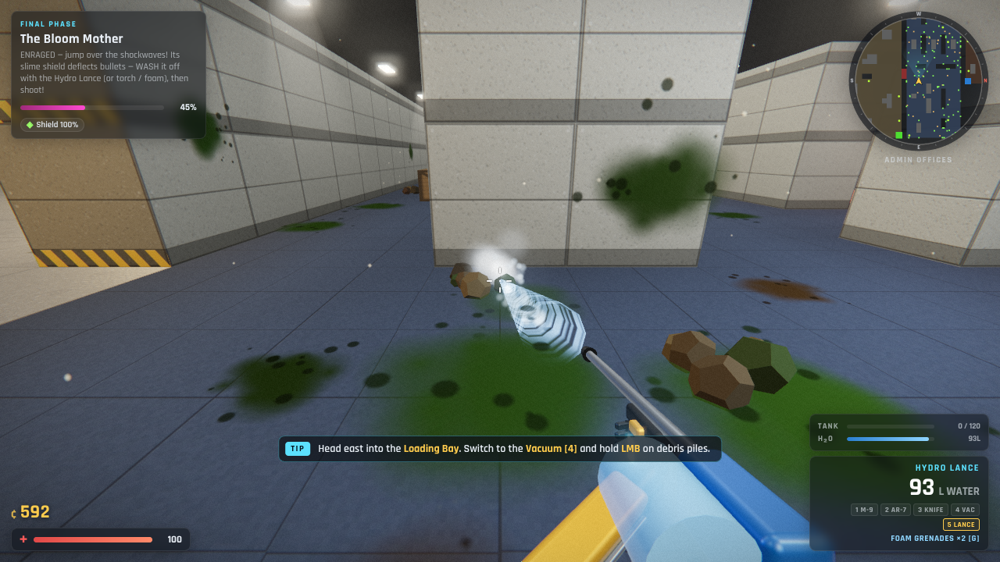
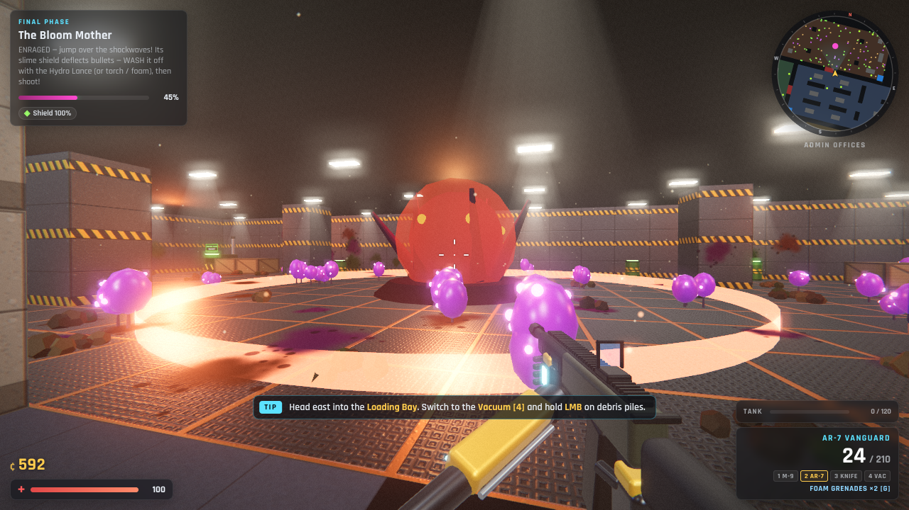

# GRIME PROTOCOL

A first-person cleanup-and-combat game that runs in the browser. Halvorsen Bioworks is overrun by a living sludge called the Bloom, and you're the contractor sent to clean it up. Vacuum debris, pressure-wash sludge and torch spore pods. Sell what you collect, upgrade your gear and fight off the creatures the grime spawns. The movement is modelled on Black Ops 3 Zombies: sprinting, sliding, slide-jumping and auto-mantling.



| | |
|---|---|
|  |  |
|  |  |

## Play

**Just open `index.html` in Chrome, Edge or Firefox.** The game is pre-built into `dist/game.js`, so it needs no install and no server.

Click **New Contract**, then click the screen to capture the mouse.

> For best performance, use a desktop browser with hardware acceleration on. If the frame rate is low, open Settings and switch Graphics to **Performance**.

## Controls

| Key | Action |
|---|---|
| WASD / Mouse | Move / look |
| Shift | Sprint |
| Space | Jump. Also grabs ledges: walk into a crate while airborne or press Space at it |
| C | Crouch. While sprinting: **slide** |
| Slide + Space | **Slide-jump** (keeps your momentum) |
| LMB | Fire / use tool / knife slash |
| RMB | Aim down sights / knife heavy stab |
| R | Reload (shotgun loads one shell at a time and can be interrupted) |
| V | Quick knife |
| G | Foam grenade (cleans, deals damage, sets off barrels) |
| F | Inspect weapon (every weapon has its own animation) |
| 1 / 2 / 3 | Gun 1 / Gun 2 / Knife |
| 4 / 5 / 6 | Vacuum / Hydro Lance / Spore Torch |
| Q / Wheel | Last weapon / cycle |
| E | Interact / buy |
| Tab | Contract stats |
| Esc or P | Pause |

## How it works

The facility has an HQ and four zones. Each zone is one **phase**. Clean a zone to **80%** and the next one unlocks.

| Phase | Zone | Main job | New threat |
|---|---|---|---|
| 1 | Loading Bay | Vacuum debris | Sludgers |
| 2 | Admin Offices | Pressure-wash sludge stains | Spitters (ranged) |
| 3 | Hydroponics | Burn spore pods | Brutes (charging tanks) |
| 4 | Reactor Core | Everything, then the boss | **The Bloom Mother** |

**The loop:**
1. Vacuum debris into your tank.
2. Empty it at a green **Disposal Chute** for credits.
3. Spend credits at the **Supply Terminal** on guns, knives, tools, upgrades and supplies.

The dirtier a zone is, the faster creatures spawn, so cleaning is also how you survive. Every couple of minutes a **Bloom Surge** brings a horde.

**Ways to spend credits:**
- **Wall-buys:** chalk outlines on the walls.
- **Supply Crate:** 950 ¢ for a random weapon.
- **Perk machines** (permanent):
  - Ironhide Ale: 200 HP.
  - Quickhands Cola: faster reload and weapon swap.
  - Rush Tonic: faster sprint, longer slides.
  - Double Pump: faster fire rate.
  - Janitor's Brew: faster cleaning.
- **Refinery** (opens in Phase 3): upgrades the gun you're holding to ×2.2 damage, bigger mags, extra pierce and a glowing camo.

Killed creatures sometimes drop **power-ups**: Max Ammo, Double Credits, Insta-Clean and Purge. Shoot green **Volatile Sludge barrels** to blow up crowds. The blast also cleans the floor around it.

**Boss:** the Bloom Mother's slime shield deflects bullets. Wash it off with the Hydro Lance (or the torch, foam grenades or barrels), then shoot the core before the shield grows back.

Progress autosaves. If you die you lose 10% of your credits and whatever is in your tank, but your cleaning progress is kept.

## Arsenal

- **Guns:**
  - M-9 Sidearm
  - Hand Cannon (revolver)
  - Hornet SMG
  - Scattergun (pump action)
  - AR-7 Vanguard
  - Mauler LMG
  - Marksman DMR (scoped)
  - Longbow .338 (bolt-action sniper, pierces through 5 enemies)
- **Knives (styled after CS:GO):** Combat, Bayonet, Huntsman, Karambit, Butterfly. Each one has its own swing, draw and inspect animation.
- **Tools:** Hoover-9 Vacuum, Hydro Lance pressure washer, Spore Torch flamethrower, Foam grenades.

## Development

```bash
npm install
```

```bash
npm run build
```

```bash
npm run dev
```

`npm run build` bundles `src/` into `dist/game.js`. `npm run dev` rebuilds on every change.

Automated checks (headless Chromium via Playwright):

```bash
node tools/playtest.cjs
```
Runs the full game end to end: movement, every tool, every phase, the boss, saving.

```bash
node tools/soak.cjs
```
Random play in every phase plus every shop button and interactable, and a save → reload → continue check.

```bash
node tools/shots.cjs
```
Takes screenshots of set scenes.

```bash
node tools/anims.cjs
```
Captures mid-animation frames of every weapon.

Code layout (`src/`): `main.js` (game loop, states, economy, save) · `level.js` (map, meshes, collision, raycasts, flow-field pathing) · `player.js` (movement) · `weapons.js` + `viewmodel.js` + `anims.js` (guns, knives, tools, first-person models and animations) · `enemies.js` (AI, spawning, boss, power-ups) · `grime.js` (cleanable debris, stains and spores) · `effects.js` (explosions, wind, barrels) · `render.js` (post-processing) · `ui.js` (HUD, minimap, shop).
